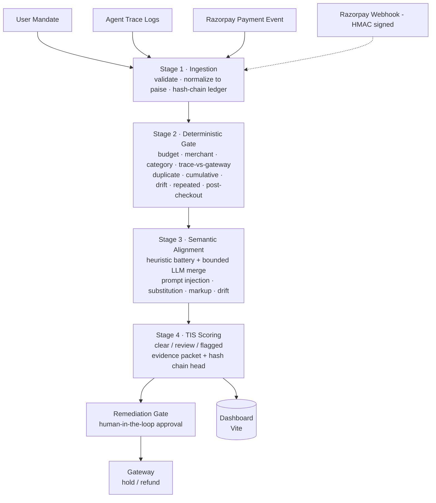

# Project Sentinel

**Agentic Payment Incident & Evidence Intelligence**

The payment rail can prove money moved. Sentinel proves whether an autonomous AI agent moved it **for the right reason, within the right authority** — and builds a tamper-evident evidence package the moment it didn't.


---

## The problem

Autonomous shopping/procurement agents can now search, select, and pay on a user's behalf. Payment rails verify that a transaction was *authorized* — but nothing verifies that the agent stayed *faithful to the user's delegated intent* while getting there. Prompt injection, merchant redirects, silent product substitution, and policy drift all look identical to a "successful payment" from the rail's point of view.

Sentinel is a **post-transaction auditor** that sits outside the agent, ingests three independent streams per session, and cross-verifies them so deviation can never be hidden behind a single trusted source:

| Stream | Source | Trust level |
|---|---|---|
| User mandate | App at delegation time | **Authoritative intent** |
| Agent trace logs | The agent's self-reported actions | **Untrusted** |
| Razorpay payment event | The gateway (signed) | **Ground truth** |

> Deviations are detected by cross-verifying the untrusted trace against the signed gateway payload and the mandate — never by believing either alone.

---

## Pipeline



**Rule:** hard, money-moving verdicts come only from deterministic, reproducible rules. The LLM (Stage 3) can *add* findings but can never soften, clear, or re-score anything — the **one-way valve**.

| Stage | Engine | Role |
|---|---|---|
| 1. Ingestion | FastAPI + Pydantic | Validates at the edge (422s, never 500s), normalizes money to int paise, persists idempotently, appends to a hash-chained ledger |
| 2. Deterministic gate | Pure Python, zero LLM | 10-rule constraint battery; gateway payload always breaks ties over the trace |
| 3. Semantic alignment | Heuristic battery, optional LLM | Detects prompt injection, product substitution, price markup, semantic drift |
| 4. Dispute & evidence | TIS scorer + packet builder | Severity-weighted score → status; signed, tamper-evident evidence packet; suggested remediation |

---

## Trust invariants

1. **Ground truth beats claims** — signed gateway payload + mandate outrank the agent trace in every conflict.
2. **No floats in evidence** — money is int paise everywhere; the hash chain rejects floats.
3. **One-way valve** — the LLM can only make a verdict stricter, never clearer; merged findings ⊇ heuristic findings; LLM-only findings cap at MINOR severity.
4. **History is never rewritten** — the ledger is append-only; re-evaluation adds, never edits.
5. **No side effect without a human** — gateway actions require an approved, atomically-claimed remediation request.
6. **Money is capped everywhere** — cumulative refunds ≤ payment amount in every gateway mode; requests capped at 1 crore / 1 MB / 300 req per 60s.
7. **Fail closed, fail loud** — no API key → refuse to start; no webhook secret → webhook disabled; bad signature → 400; misconfig fallback → logged CRITICAL.
8. **Every finding is grounded** — each finding carries an `evidence_ref`; each score carries its full derivation.

---

## Scoring — Transaction Integrity Score (TIS)

TIS blends two independently-computed sub-scores: a deterministic score from Stage 2 (hard, reproducible rules) and a semantic score from Stage 3 (heuristic battery, optionally LLM-augmented). The deterministic side always dominates the weighting, and either an explicit override or a low blended score can send a transaction to `flagged`.

```
s_det = max(0, 1 − Σ penalty(constraint))    # deduped per constraint, worst breach kept
s_sem = semantic alignment score              # 1 − Σ finding-penalty, from Stage 3

TIS   = round(100 × (0.6·s_det + 0.4·s_sem), 1)
```

**Per-constraint penalty table** (Stage 2, deterministic):

| Constraint | Severity | Penalty |
|---|---|---|
| `budget` / `cumulative_budget` | hard | 0.30 + 0.20 × min(1, breach_ratio) |
| `merchant` | hard | 0.50 |
| `trace_gateway` (trace vs. gateway mismatch) | hard | 0.40 |
| `duplicate_payment` | hard | 0.40 |
| `merchant_drift` | hard | 0.35 |
| `repeated_action` | soft | 0.15 |
| `category` | soft | 0.10 |
| `time_window` | soft | 0.10 |
| `post_checkout` | soft | 0.10 |
| (unknown constraint) | — | 0.10 |

`breach_ratio` for budget checks is `(settled − budget) / budget`, so the penalty scales with how far over the line the settlement went rather than treating every breach the same. Checks are deduplicated per constraint across payment- and step-level rows, keeping only the worst (max) breach ratio — so one constraint can't be penalized twice for the same underlying problem.

**Semantic penalty table** (Stage 3, same table for both mock and LLM-merged mode):

| Finding | Severity | Penalty |
|---|---|---|
| `PROMPT_INJECTION` | CRITICAL | 0.35 |
| `PRODUCT_SUBSTITUTION` | MAJOR | 0.30 |
| `SEMANTIC_DRIFT` | MINOR | 0.30 |
| `PRICE_MARKUP` | MAJOR | 0.20 |

`s_sem = 1 − min(1, Σ these penalties)`. When the LLM is enabled it can only ever *add* to this finding set (never remove or downgrade one the heuristic battery already found), and any LLM-only finding with no heuristic corroboration is capped at MINOR — so a compromised or jailbroken LLM auditor can at worst push a transaction into `review`, never clear one that should be `flagged`.

**Status derivation:**

```
status = flagged   if ANY hard-constraint failure OR ANY CRITICAL finding   (hard override)
       = flagged   elif TIS < 60   (flagged_max_tis)
       = review    elif TIS < 90   (clear_min_tis)
       = clear     otherwise
```

The hard override exists so a clean-looking blended score can't mask a single disqualifying fact — e.g. a prompt injection with otherwise clean constraints must not sit indefinitely in "review."

Every derivation — which constraints fired, their breach ratios, the exact penalties applied, the weights used, and whether the hard override triggered — is stored in `scores.derivation` and rendered in full in every evidence export. Nothing about the score is a black box.

> Note: this replaces an earlier binary formula from the original architecture proposal (`S_det ∈ {0,1}`, no breach-ratio scaling, no per-constraint weighting) with the severity-weighted version above, arrived at after the audit rounds.

---

## Tech stack

| Concern | Choice | Why |
|---|---|---|
| Backend | FastAPI + Pydantic v2 | Async, typed, free OpenAPI docs |
| Database | SQLAlchemy — SQLite (dev) / PostgreSQL (prod via `DATABASE_URL`) | Zero external services for the demo, drop-in swap for production |
| LLM |  Ollama-native endpoint | Bounded, single call, strict JSON contract, deterministic `mock` fallback |
| Payments | Razorpay test mode + mock/emulated gateway | Real test-mode payment and webhook for the demo; enforces provider invariants (refund caps, TOCTOU-safe) in every mode |
| Dashboard | Vite + vanilla JavaScript | Incident board, trace replay, score details, evidence verification and download |
| Tests | pytest + HTTP deployment check | Authentication, request guards, database setup, persistence and refund caps |

---

## Security highlights

- Request path: rate limit → body-size cap → API-key check → route (webhook is the sole unauthenticated route, verified instead by HMAC-SHA256 over the raw body).
- Append-only, hash-chained evidence ledger with exact-row tamper localization.
- Every evidence export is HMAC-signed and independently re-verifiable.
- Global error handler never leaks internals; all attacker-influenced log values are sanitized against log injection.

See the full [architecture doc](./project-sentinel-architecture.txt) for the constraint battery, findings taxonomy, gateway strategy, remediation state machine, and the complete threat-model table.

---

## Repository layout

```text
Project-Sentinel/
├── app.py               # Vercel ASGI entrypoint; API + built dashboard
├── vercel.json          # FastAPI deployment and frontend build
├── neon.ts              # Neon service configuration (PostgreSQL)
├── pyproject.toml       # uv workspace and shared Python tools
├── uv.lock              # Python dependency lockfile
├── package.json         # npm workspace, Neon tools and Turbo CLI
├── turbo.json           # Native Python + JavaScript tasks
├── apps/api/src/sentinel/ # API, engines, models, config/seeds and tools
├── apps/web/            # Minimal operator dashboard (Vite)
├── scripts/verify_deployment.py
└── tests/               # Deployment and security regression checks
```

## Local setup

Use Python 3.12, uv, and Node.js 22.12+ with npm 11. Run from this repository root:

```bash
uv sync --all-packages --locked
npm ci
# For local SQLite development, copy the example and set an operator key:
cp .env.example .env
# For Neon, follow the linked project setup below instead.
npm run build
npm run db:init
npm run dev
```

The dashboard runs at http://127.0.0.1:5173 and proxies API requests to port 8000.
Enter your API_KEY in the dashboard's operator-key field. The key is retained
only in this tab's memory; it is never embedded in the bundle or stored in
localStorage. Disconnect clears the key and loaded case data. This dashboard
uses the existing shared operator-key model; it is not a multi-user login system.

To serve the production frontend and API together locally:

```bash
uv run --locked uvicorn app:app --host 127.0.0.1 --port 8000
```

Settings load .env, then .env.local, with process environment variables taking
precedence. Keep secrets in ignored files and Vercel's server-side environment.
The new setup preserves the native uv integration introduced in Turborepo 2.11;
Python packages have no package.json wrappers. The experimental Python flags
are enabled in turbo.json.

## Neon PostgreSQL

The project declares only PostgreSQL. Keep the generated neon.ts configuration.
To link this repository to an existing authorized Neon project:

```bash
neon init -y --org-id YOUR_ORG --project-id YOUR_PROJECT --branch production --services postgres
neon deploy
```

The CLI pulls DATABASE_URL, DATABASE_URL_UNPOOLED and NEON_BRANCH into .env.local
(or an existing .env). Add API_KEY and a separate SENTINEL_SIGNING_SECRET to the
same ignored file. Preserve existing values when pulling environment updates.

The API uses the pooled DATABASE_URL for requests through SQLAlchemy and
psycopg. Standard postgres:// and postgresql:// URLs are normalized to the
psycopg driver while retaining TLS options. NullPool avoids idle connections
in each serverless instance. Schema initialization uses DATABASE_URL_UNPOOLED
when supplied. Test schema changes on a temporary Neon branch first, then run
`npm run db:init` for the intended deployment branch. The initializer only
creates missing tables; future schema alterations need versioned migrations.

## Vercel deployment

Import the repository with its root directory set to the repository root.
vercel.json selects FastAPI and builds apps/web; app.py exports the API and
mounts the generated frontend after API routes. Both share one origin. There
is no Cloudflare service or configuration.

Configure Preview and Production variables separately:

| Variable | Value |
| --- | --- |
| DATABASE_URL | Neon pooled PostgreSQL URL, including sslmode=require |
| API_KEY | Random operator key; never a VITE_ or NEXT_PUBLIC_ variable |
| SENTINEL_SIGNING_SECRET | Separate random evidence-signing secret |
| APP_ENV | production |
| AUTO_CREATE_SCHEMA | false |
| RAZORPAY_MOCK | 1 for a demo; 0 with explicit Razorpay credentials |
| SEMANTIC_MODE | mock, or llm with a hosted HTTPS endpoint and model |

See .env.vercel.example for names, without real credentials. Initialize the
selected database before deploying. Vercel sets VERCEL=1 automatically; the
app rejects SQLite there and skips schema creation on cold starts. Production
disables interactive API docs. Vercel's build does not change the database.
Use a separate Neon branch for preview deployments to isolate preview data.

Mock gateway operations persist in PostgreSQL. Row locks serialize refund
caps across instances; mock operations do not move real money. Request rate
limits in the app are per-instance; use Vercel Firewall for a global limit.
For live payments, configure RAZORPAY_KEY_ID, RAZORPAY_KEY_SECRET and the webhook
secret explicitly; invalid provider configuration fails instead of becoming a
mock. Webhook URL: https://YOUR_DOMAIN/api/v1/webhooks/razorpay.

## Verification

```bash
npm run build
npm run lint
npm test
uv run --locked python scripts/verify_deployment.py --env-file .env.local
```

Automated tests use isolated local SQLite files and never use the pulled Neon
production URL. The HTTP verification script starts the app against the chosen
PostgreSQL database, checks the built dashboard, authentication, ingest, trace,
evidence, export, human-approved mock refunds, API restart persistence, and the
refund cap. It creates uniquely named deployment_check_* demo incidents, always
uses mock payments, and never calls a live payment provider. Initialize a new
test database first, or pass --initialize. No credentials are printed.

The original dashboard and historical 354-test suite described in earlier
versions were absent from this checkout. The current dashboard and regression
checks are included here.

---

## Strategy — why this problem

An earlier direction (an AI cash-flow/finance-controller idea) was scrapped after validation showed Razorpay's own 2026 product surface (Cashflow Forecaster, Insights Agent, RAY co-pilot, Payout/Receivables/Bookkeeping Agents) already covers that ground critically. The pivot to **agentic payment incident & evidence intelligence** targets a gap that's real but not yet owned:

- Payment rails and emerging trust protocols (Mastercard Verifiable Intent, Experian Agent Trust, FIDO agentic auth) prove a transaction was *authorized* — not that the agent stayed faithful to delegated intent.
- Post-transaction accountability, dispute evidence, and remediation for *agent-caused* incidents remain fragmented and early.
- The build is technically deep enough to demonstrate real engineering (deterministic + semantic + cryptographic layers) rather than an LLM chat wrapper.
